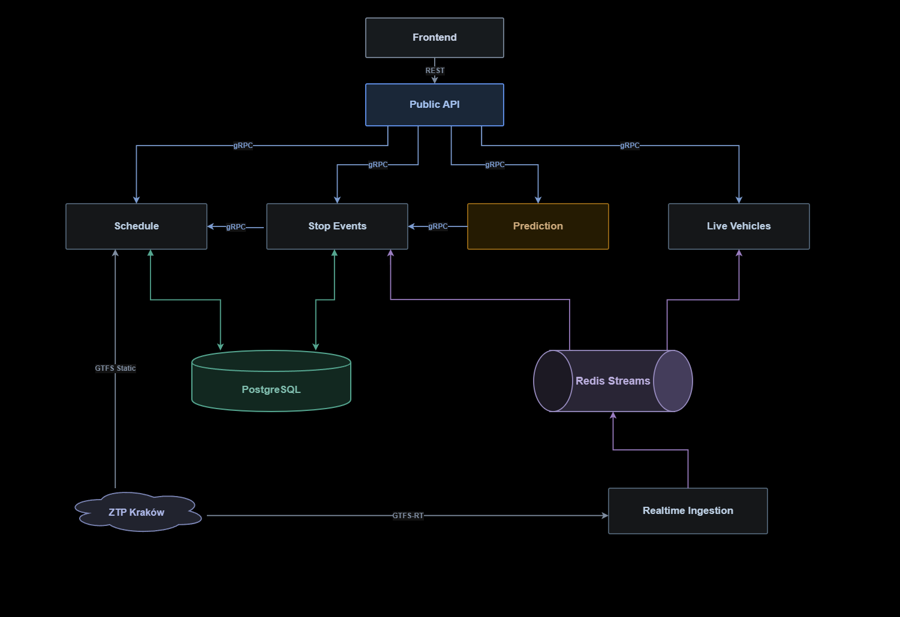

# KRKtransit - mapa na żywo, statystyki i prognozy opóźnień pojazdów komunikacji miejskiej w Krakowie

Platforma do śledzenia na żywo pojazdów komunikacji miejskiej (MPK, Mobilis) w Krakowie. Bazuje na danych udostępnianych przez Zarząd Transportu Publicznego (ZTP) zgodnie ze specyfikacją GTFS (Static & Realtime).

Prognozuje opóźnienia autobusów na pięciu najbliższych przystankach z wykorzystaniem uczenia maszynowego i modelu LightGBM. Model obejmuje linie 139, 163, 179, 304 i 578. Pozostałe linie wykorzystują prognozę z TripUpdates udostępnianą przez ZTP.

Platforma umożliwia też identyfikację odcinków, na których powstają największe opóźnienia, oraz monitorowanie długofalowych trendów opóźnień dla każdej linii.

Aby uniknąć fałszowania wyników przez nierealistyczne opóźnienia, statystyki nie uwzględniają pierwszego i ostatniego przystanku kursu.

Strona: https://krktransit.pl/

Frontend: https://github.com/grzechuzz/KRKtransit_frontend

GTFS: https://gtfs.org/documentation/overview/

Dane ZTP: https://gtfs.ztp.krakow.pl/


## Architektura

System składa się z sześciu serwisów, z których każdy realizuje konkretny etap przepływu danych. Moduły serwisów nie importują się bezpośrednio nawzajem, są rozdzielone względem odpowiedzialności i komunikują się przez kontrakty gRPC oraz Redis Streams. Rozkłady jazdy i zdarzenia na przystankach są trzymane w bazie danych PostgreSQL, podzielonej na dwa schematy: `gtfs_schedule` i `stop_events`.



| Serwis | Rola |
|---|---|
| Schedule | Pobiera i ładuje dane GTFS Static (trasy, przystanki, rozkłady, kształty tras) dla MPK i Mobilis. Wykrywa zmiany w plikach poprzez hashowanie SHA-256. Przez gRPC udostępnia hash aktualnego rozkładu, dane kursów, kształty tras i trasy linii. |
| Realtime Ingestion | Pobiera VehiclePositions i TripUpdates, a następnie publikuje je w Redis Streams, osobno dla każdego źródła. |
| Stop Events | Czyta strumienie i wykrywa zdarzenia na przystankach trzema metodami (patrz niżej). Zapisuje je do bazy danych, liczy statystyki i cache'uje je w Redisie. Przez gRPC udostępnia statystyki (największe opóźnienia, opóźnienia na trasach, punktualność, trend, mapa opóźnień) oraz zdarzenia na przystankach dla linii. |
| Live Vehicles | Czyta strumienie i trzyma w pamięci aktualne pozycje pojazdów, ich postęp na kursie oraz prognozy ZTP. Przez gRPC udostępnia pozycje pojazdów i prognozy ZTP dla kursów. |
| Prediction | Serwis w Pythonie. Liczy prognozy modelu LightGBM na podstawie zdarzeń ze Stop Events. Przez gRPC udostępnia prognozy przyjazdów. |
| Public API | Udostępnia frontendowi REST: pozycje na żywo, geometrię tras, najbliższe przystanki z prognozami, statystyki i mapę opóźnień. Łączy dane z pozostałych serwisów. |

## Detekcja zdarzeń na przystankach

| Metoda | Trigger | Źródło czasu |
|---|---|---|
| STOPPED_AT | Pojazd wysyła status STOPPED_AT | Timestamp GPS |
| SEQ_JUMP | Skok w sekwencji przystanków (pominięte przystanki) | Ostatnia prognoza z TripUpdates |
| TIMEOUT | Pojazd rozpoczął nowy kurs (zamykanie ostatniego przystanku poprzedniego) | Pierwsza prognoza z TripUpdates |

## Uruchomienie

Wymagania:

- Docker
- Git
- Wolny port `8080`

```bash
git clone --config core.autocrlf=false https://github.com/grzechuzz/KRKtransit.git
cd KRKtransit
./run.sh
```

Na Windowsie polecenia należy wykonać w Git Bash, a opcja `core.autocrlf=false` chroni skrypty przed zmianą końców linii. Skrypt sam tworzy plik `.env` z losowymi hasłami, buduje obrazy i uruchamia wszystkie usługi. Pierwsze uruchomienie może potrwać kilka minut.

Sprawdzenie, że backend odpowiada:

```bash
curl http://127.0.0.1:8080/health
curl http://127.0.0.1:8080/v1/vehicles/positions
```

Po uruchomieniu system dopiero zaczyna zbierać dane, więc statystyki i mapa opóźnień będą na początku puste, a prognozy modelu pojawią się po wykryciu pierwszych przystanków.

Jeśli port `8080` jest zajęty, `./run.sh` zakończy się błędem. Zmień wtedy w pliku `.env` wartość `PUBLIC_API_HOST_PORT` na inny wolny port i uruchom `./run.sh` ponownie.

## Użyte technologie

- Java 25, Spring Boot 4
- Python 3.13, LightGBM
- gRPC
- PostgreSQL 17
- Redis 7 (Redis Streams + cache)
- Docker Compose
- GitHub Actions (CI)
